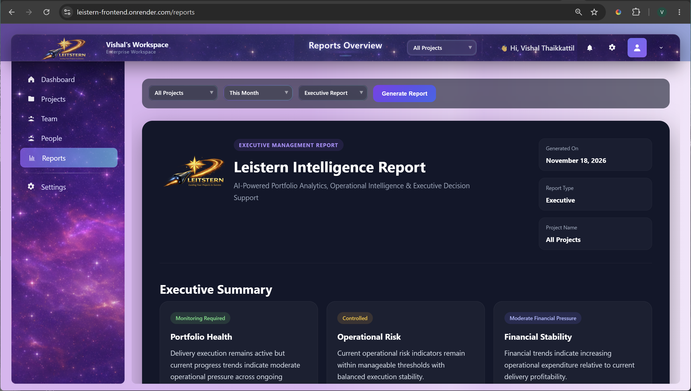

# LEITSTERN
### AI-Assisted Full-Stack SaaS Platform

**An independently developed software platform combining full-stack engineering, cloud-based data management, deterministic project intelligence, and AI-assisted decision support.**

LEITSTERN demonstrates the integration of modern web technologies, structured application data, intelligent decision-support mechanisms, and human-in-the-loop AI interaction.

**Technologies:** React.js · JavaScript · Node.js · Express.js · Firebase · OpenAI API · n8n

---

## 1. Project Overview

LEITSTERN is a multi-tenant SaaS platform designed to help organisations manage projects, monitor operational performance, analyse project data, and support management decisions.

The platform brings together project and task management, KPI dashboards, workload and cost analysis, deterministic decision engines, and an AI-assisted interaction layer.

Its development focuses on connecting structured operational data with analytical functionality and controlled AI-assisted recommendations.

The project demonstrates practical experience in:

- Full-stack application development.
- Frontend and backend integration.
- REST API development.
- Cloud database integration.
- Authentication and organisation-based access control.
- Data visualisation and analytical logic.
- AI service integration.
- Human-in-the-loop application workflows.
- Software debugging and technical documentation.

**Live Application:** [LEITSTERN – Live Demo](https://leistern-frontend.onrender.com)

---

## 2. Technology Stack

| Category | Technologies |
|---|---|
| Frontend | React.js, JavaScript, HTML5, CSS3 |
| Backend | Node.js, Express.js |
| API Architecture | RESTful APIs |
| Authentication | Firebase Authentication |
| Database | Firebase Cloud Firestore |
| AI Integration | OpenAI API, n8n |
| Data Visualisation | Chart.js, Recharts |
| Version Control | Git, GitHub |
| Project Management | Azure DevOps Boards |
| Deployment | Render |

---

## 3. System Architecture

LEITSTERN follows a full-stack architecture that separates frontend responsibilities, backend application logic, cloud-based data management, and AI integration.

### High-Level Architecture

```text
                     USER
                       |
                       v
                REACT FRONTEND
                       |
                       v
               NODE.JS / EXPRESS
                  BACKEND API
                       |
             +---------+---------+
             |                   |
             v                   v
       FIREBASE              NAVIS AI
     AUTHENTICATION         INTEGRATION
             |                   |
             v                   v
       CLOUD FIRESTORE       n8n WORKFLOW
             |                   |
             v                   v
      APPLICATION DATA       OPENAI API
             |
             v
    PROJECT INTELLIGENCE
          ENGINES
```

### Architectural Responsibilities

**Frontend**
- User interface and application navigation.
- Dashboard visualisation.
- Project, task, and team management.
- NAVIS interaction and action previews.

**Backend**
- REST API endpoints.
- Application business logic.
- Data validation and processing.
- Authentication and access-related checks.
- Structured action execution.

**Database and Authentication**
- Firebase Authentication for user authentication.
- Cloud Firestore for application data.
- Organisation-scoped data management.

**AI Integration**
- n8n workflow orchestration.
- OpenAI API integration.
- Structured AI responses.
- Controlled interaction between AI suggestions and application functionality.

For a detailed explanation, see:

**[System Architecture Documentation](docs/architecture.md)**

---

## 4. NAVIS – AI-Assisted Decision Support

NAVIS is an AI-assisted component developed within LEITSTERN to connect conversational AI capabilities with project information and application workflows.

It combines AI-generated recommendations with deterministic application logic to support project analysis and management decisions.

### 4.1 Technical Integration

The NAVIS integration follows this workflow:

1. The user submits a request through the React frontend.
2. The LEITSTERN backend receives and processes the request.
3. An n8n workflow orchestrates the interaction with the OpenAI API.
4. The AI response is returned in a structured format containing information such as replies, suggestions, and supported action proposals.
5. The frontend presents the response for user review.

### 4.2 Human-in-the-Loop Action Execution

NAVIS is designed around controlled interaction rather than unrestricted AI execution.

- AI-generated recommendations are presented to the user.
- Supported structured actions can be previewed before execution.
- The manager can approve or cancel proposed operations.
- The backend validates approved actions before processing them.
- Supported operations update application data and trigger relevant recalculations.
- Activity logging and undo functionality support traceability for supported operations.

### 4.3 AI and Deterministic Intelligence

An important architectural distinction is that not every intelligent capability in LEITSTERN is generated by AI.

Project health, workload, cost, budget, deadlines, risk scoring, and priority intelligence use application-defined logic.

NAVIS complements these engines through conversational interaction, contextual explanations, and AI-generated recommendations.

### 4.4 Relevance to Human-AI Interaction

NAVIS explores how AI-generated insights can be incorporated into an interactive software environment while keeping users involved in reviewing and authorising consequential actions.

**Development Status:** NAVIS is undergoing further development and stabilisation. Some functionalities may not currently be available in the live deployment.

For further technical details:

**[NAVIS AI Architecture and Technical Documentation](docs/navis-ai.md)**

---

## 5. Core Application Capabilities

LEITSTERN incorporates several connected application modules.

### Project and Task Management
- Project creation and management.
- Task tracking and status management.
- Project-level task organisation.
- Deadline monitoring.

### Dashboard and Analytics
- KPI monitoring.
- Project performance visualisation.
- Financial and operational indicators.
- Project-level analytical views.

### Resource and Workload Management
- Team workload monitoring.
- Estimated-hours-based workload calculations.
- Resource allocation analysis.
- Resource reallocation support.

### Cost and Budget Intelligence
- Estimated and actual cost calculations.
- Budget monitoring.
- Cost-overrun analysis.
- Cost optimisation insights.

### Project Intelligence
- Project health assessment.
- Risk scoring.
- Deadline analysis.
- Dynamic task prioritisation.
- Structured action recommendations.

### Reporting
- Reporting and analytical views.
- Filtered report generation.
- PDF export functionality.

### Organisation-Based Management
- Organisation-scoped project data.
- User roles and access restrictions.
- Organisation-level data separation.

---

## 6. Application Screenshots and Visual Showcase

The following screenshots demonstrate the application interface and selected functional modules.

### 6.1 Main Dashboard

The central dashboard provides an overview of project performance, key performance indicators, and operational information.


### 6.2 Dashboard Analytics

Visual representation of project metrics, performance indicators, and analytical information.


### 6.3 Dashboard Overview

An additional view demonstrating the dashboard layout and application interface.


### 6.4 Project Management

Project-level information and project management functionality.


### 6.5 Team Management

Team-related information and resource management interfaces.


### 6.6 Reports and Analytics

Reporting and analytical views within the application.



### 6.7 NAVIS – AI Interface

Interface preview of NAVIS, the AI-assisted decision-support component within LEITSTERN.


*Note: NAVIS is undergoing further development and stabilisation. This screenshot demonstrates its interface and intended functionality; it does not guarantee that all features are operational in the live deployment.*

---

## 7. Dashboard Comparison Preview

The following comparison preview demonstrates the dashboard design and visual presentation of LEITSTERN.


---

## 8. Software Engineering Contributions

LEITSTERN involves implementation across multiple areas of software engineering.

### 8.1 Frontend Engineering

- Developed application interfaces using React.js.
- Implemented reusable UI components.
- Built interactive dashboard visualisations.
- Integrated frontend components with backend services.
- Developed project, team, and reporting views.
- Connected user interactions with application workflows.

### 8.2 Backend Engineering

- Developed backend services using Node.js and Express.js.
- Implemented RESTful API endpoints.
- Developed application business logic.
- Implemented data-processing and validation functionality.
- Integrated backend services with frontend components.
- Developed structured application workflows and action handlers.

### 8.3 Database and Authentication

- Integrated Firebase Authentication.
- Implemented Cloud Firestore data management.
- Developed organisation-scoped data handling.
- Implemented role-aware access restrictions.
- Integrated cloud-based data storage with application services.

### 8.4 AI Integration

- Integrated the OpenAI API into application workflows.
- Used n8n for AI workflow orchestration.
- Developed NAVIS conversational functionality.
- Implemented structured AI-generated responses.
- Connected supported action proposals with application operations.
- Introduced user review and approval before supported changes.

### 8.5 Application Intelligence

- Developed workload calculations based on estimated hours.
- Implemented cost and budget calculations.
- Developed project risk and health analysis.
- Implemented dynamic task-priority logic.
- Developed resource reallocation functionality.
- Connected analytical outputs with management-oriented recommendations.

---

## 9. Engineering and Development Approach

LEITSTERN is independently developed and managed using structured software engineering practices.

Development activities include:

- Git-based version control.
- GitHub repository management.
- Agile project planning and task tracking.
- Azure DevOps Boards.
- Iterative feature development.
- Deployment configuration and troubleshooting.
- Debugging and application maintenance.
- Technical documentation.
- Manual functional testing.

The development process involved resolving issues across frontend components, backend APIs, authentication, Firestore data handling, application calculations, and AI response processing.

For further details:

- **[Development Workflow and DevOps](docs/development-and-devops.md)**
- **[Engineering Case Studies](docs/engineering-case-studies.md)**

---
## Technical Work Sample – CHM Application

A dedicated technical overview prepared for the Student Research Assistant – Full-Stack Developer position at the Center for Humans and Machines.

**[View LEITSTERN Technical Work Sample (PDF)](CHM_Technical_Work_Sample.pdf)**

## 10. Engineering Case Studies and Technical Documentation

The project is documented across several technical areas.

| Documentation | Description |
|---|---|
| [System Architecture](docs/architecture.md) | Application architecture and component responsibilities |
| [NAVIS AI](docs/navis-ai.md) | AI integration, workflow orchestration, and human approval |
| [Intelligence Engines](docs/intelligence-engines.md) | Workload, cost, risk, and decision-support logic |
| [Development and DevOps](docs/development-and-devops.md) | Development workflow, project management, and deployment |
| [Engineering Case Studies](docs/engineering-case-studies.md) | Selected implementation challenges and engineering decisions |

These documents provide additional context beyond the screenshots and high-level project overview.

---

## 11. Validation and Current Limitations

LEITSTERN is a functioning thesis-stage software implementation with substantial functionality manually tested during development.

Manual testing covered application workflows, API interactions, data handling, dashboard behaviour, NAVIS response processing, supported action execution, and relevant error corrections.

The following limitations are important when interpreting the current implementation:

- Formal automated test coverage has not been established.
- Performance and concurrent-user benchmarks have not been completed.
- Formal security penetration testing has not been established.
- AI response quality has not undergone formal benchmark evaluation.
- Production-scale scalability has not been demonstrated.
- Live integrations with external project-management systems are not currently implemented.
- Long-term production monitoring and operational assurance processes are not established.

The platform supports manual data management and validated Excel imports; it should not be interpreted as having automatic synchronisation with external systems.

The deterministic intelligence engines provide structured analysis based on available input data. Their outputs are not formally validated predictions of project success or failure.

NAVIS is an AI assistant, not an unquestionable source of truth. Recommendations require human judgement and review.

These limitations define opportunities for further engineering, testing, evaluation, and research.

---

## 12. Live Demonstration

The application is deployed and accessible online.

**[Open LEITSTERN – Live Application](https://leistern-frontend.onrender.com)**

NAVIS functionality is currently undergoing further development and stabilisation.

A guided demonstration of the application, technical architecture, implemented features, and AI integration can be provided upon request.

---

## 13. About the Developer

**Vishal Thaikkattil Vidyadharan**

Master's Student in Technical Management | Software Engineer

**Hochschule Emden/Leer, Germany**

Professional experience in frontend development, full-stack application development, backend engineering, Python, SQL, data analytics, and AI-integrated software development.

**Email:** vishaltvger10@gmail.com

**GitHub:** [Vishal-dev-10](https://github.com/Vishal-dev-10)

---

*LEITSTERN is an independently developed software engineering project demonstrating practical experience in full-stack application development, cloud-based data management, deterministic project intelligence, and controlled AI-assisted decision support.*
