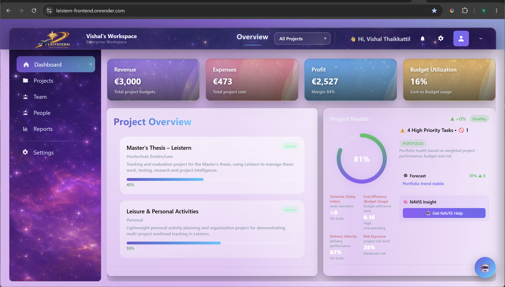
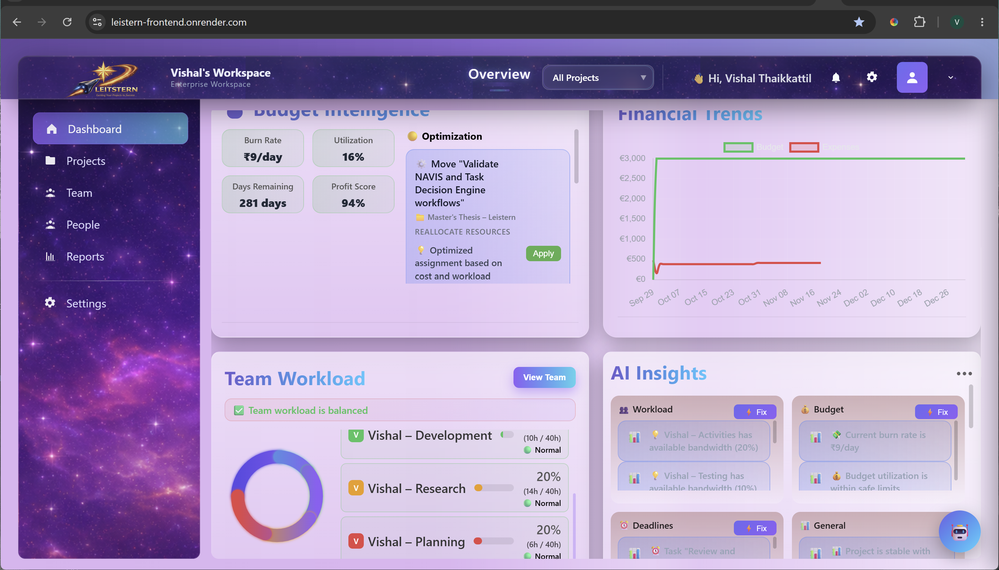
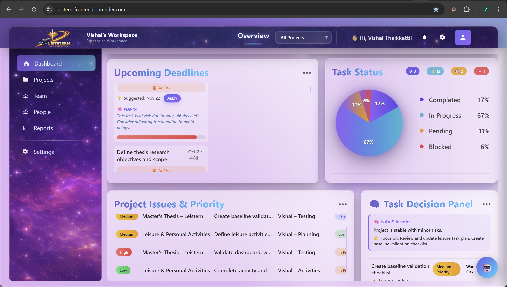
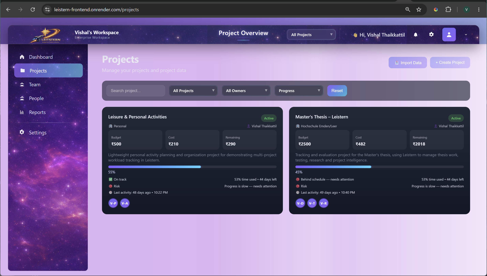
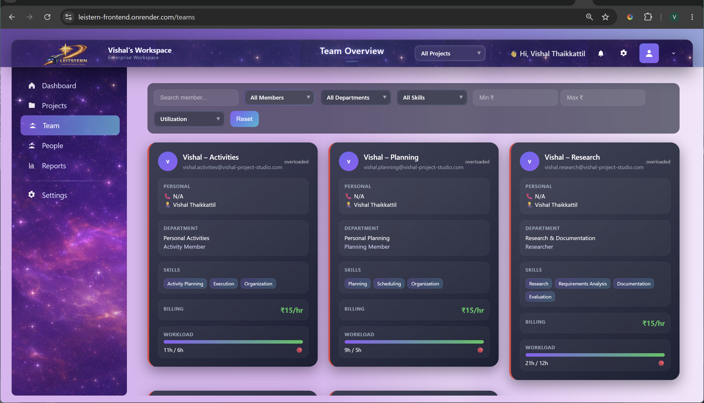
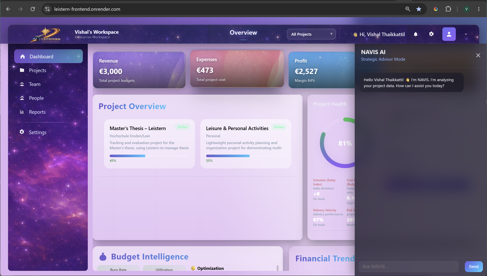
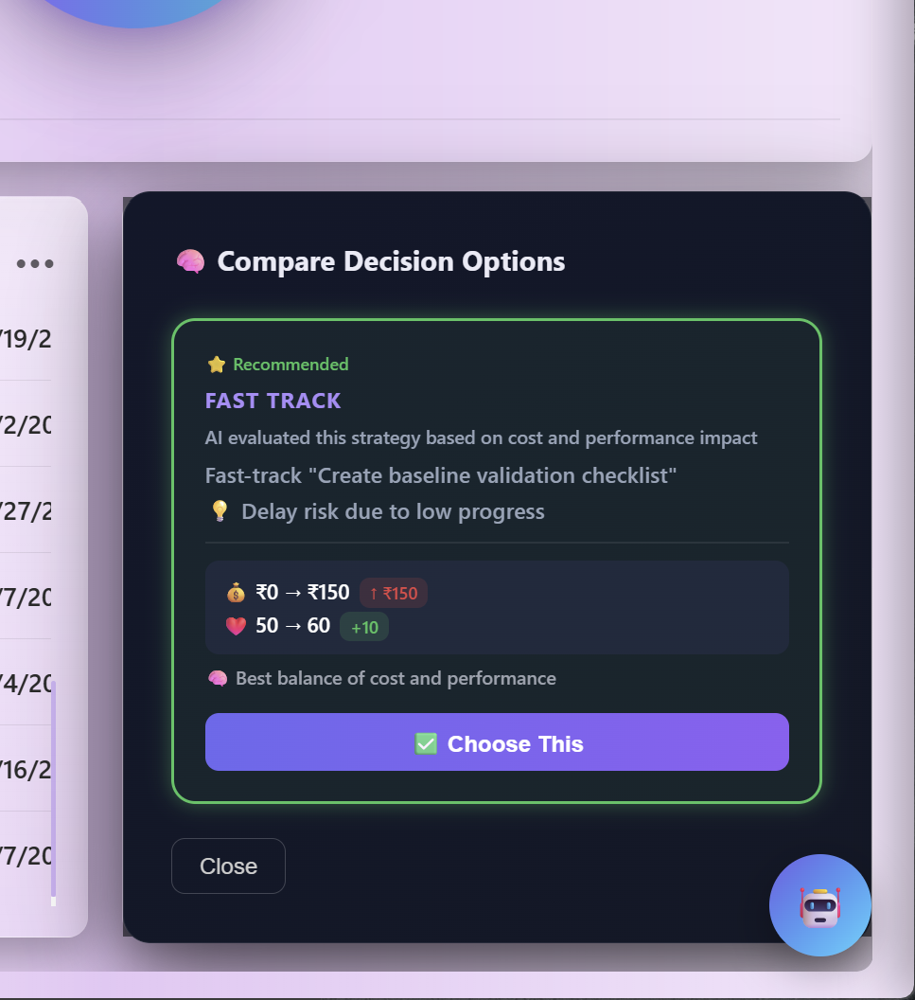

# LEITSTERN
### AI-Powered Full-Stack SaaS Platform

**An independently developed software platform combining full-stack engineering, cloud-based data management, intelligent automation, and AI-powered decision support.**

**Technologies:** React.js · Node.js · Express.js · Firebase · JavaScript · OpenAI API · n8n

---

## 1. Project Overview

LEITSTERN is an AI-powered SaaS platform designed to help organisations manage projects, monitor performance, analyse operational data, and support management decisions.

The platform combines modern frontend and backend technologies with cloud-based data management, application analytics, and AI integration.

Its development focuses on building an integrated software environment where project information, operational metrics, and intelligent recommendations work together to support informed decision-making.

The project demonstrates practical experience in full-stack software engineering, application architecture, API development, database integration, AI integration, and intelligent application functionality.

**Live Application:** [LEITSTERN – Live Demo](https://leistern-frontend.onrender.com)

---

## 2. Technology Stack

| Category | Technologies |
|---|---|
| Frontend | React.js, JavaScript, HTML5, CSS3 |
| Backend | Node.js, Express.js |
| APIs | RESTful APIs |
| Authentication | Firebase Authentication |
| Database | Firebase Cloud Firestore |
| AI Integration | OpenAI API, n8n |
| Data Visualisation | Chart.js, Recharts |
| Version Control | Git, GitHub |
| DevOps | Azure DevOps, CI/CD |

---

## 3. System Architecture

LEITSTERN follows a full-stack application architecture connecting the user interface, backend services, cloud database, and AI integration layer.

### High-Level Architecture

```text
                  USER
                    |
                    v
             REACT.JS FRONTEND
                    |
                    v
             NODE.JS / EXPRESS
                BACKEND API
                    |
          +---------+---------+
          |                   |
          v                   v
    FIREBASE              NAVIS AI
 AUTHENTICATION        INTEGRATION
          |                   |
          v                   v
   CLOUD FIRESTORE       AI SERVICES
          |
          v
    APPLICATION DATA
```

The architecture separates frontend responsibilities, backend application logic, cloud-based data management, and AI-powered functionality.

For a more detailed explanation, see:

**[System Architecture Documentation](docs/architecture.md)**

---

## 4. NAVIS – AI-Powered Decision Support Engine

NAVIS is an AI-powered component developed within LEITSTERN to assist users through contextual analysis, intelligent recommendations, and structured actions.

### Key Capabilities

- Project health assessment.
- Intelligent risk detection.
- AI-generated recommendations.
- Cost optimisation insights.
- Structured action generation.
- Workflow automation.
- Decision-support capabilities.

NAVIS connects AI-generated insights with application functionality, enabling users to interact with intelligent recommendations through the platform.

The component explores how AI can support human decision-making by translating contextual information into actionable insights.

### Human-AI Interaction

NAVIS provides an application environment in which users can interact with AI-generated insights, review recommendations, and initiate structured actions.

This creates an interesting connection to human-AI collaboration and intelligent decision-support systems.

**Development Status:** NAVIS is undergoing further development and stabilisation. Some functionalities may not currently be available in the live deployment.

---

## 5. Core Application Capabilities

The platform incorporates several functional modules:

- Project and task management.
- KPI monitoring and dashboard analytics.
- Resource management and allocation.
- Project health assessment.
- Risk detection and prioritisation.
- Cost optimisation.
- AI-assisted recommendations.
- Organisation-based project management.
- Reporting and performance monitoring.

---

## 6. Application Screenshots & Visual Showcase

The following screenshots showcase the application interface, dashboard functionality, project management modules, team management, reporting capabilities, and NAVIS interface.

### 6.1 Main Dashboard

The central dashboard provides an overview of project performance, key performance indicators, and operational information.



### 6.2 Dashboard Analytics

Visual representation of project metrics, performance indicators, and analytical information.



### 6.3 Dashboard Overview

An additional view demonstrating the dashboard layout and application interface.



### 6.4 Project Management

Project-level information and project management functionalities.



### 6.5 Team Management

Team-related information and resource management interfaces.



### 6.6 Reports and Analytics

Reporting and analytical views within the application.


### 6.7 NAVIS – AI Interface

Interface preview of NAVIS, the AI-powered decision-support component within LEITSTERN.



*Note: NAVIS is currently undergoing further development and stabilisation. The screenshot demonstrates its interface and intended functionality rather than guaranteeing that all features are operational.*

---

## 7. Dashboard Comparison Preview

The following comparison preview demonstrates the dashboard design and visual presentation of LEITSTERN.

It provides a visual overview of the dashboard interface and its development.



---

## 8. Software Engineering Contributions

The project involves practical implementation across multiple areas of software engineering.

### Frontend Engineering

- Developed responsive interfaces using React.js.
- Implemented reusable UI components.
- Built interactive dashboard visualisations.
- Integrated frontend components with backend services.
- Developed application views for project, team, and reporting functionalities.

### Backend Engineering

- Developed backend services using Node.js and Express.js.
- Implemented RESTful APIs.
- Developed application logic and data-processing functionality.
- Integrated backend services with frontend components.
- Implemented application workflows and structured actions.

### Database and Authentication

- Integrated Firebase Authentication.
- Implemented Cloud Firestore data management.
- Developed organisation-based application data separation.
- Implemented user authentication and access management.
- Integrated cloud-based data storage with application services.

### AI Integration

- Integrated AI services into application workflows.
- Developed NAVIS decision-support functionality.
- Implemented structured AI-generated actions and recommendations.
- Connected intelligent suggestions with application operations.
- Explored AI-assisted decision-making through interactive application functionality.

---

## 9. Development Approach

LEITSTERN is independently developed and managed using structured software engineering practices.

Development activities include:

- Git-based version control.
- GitHub repository management.
- Agile development methodologies.
- Azure DevOps Boards.
- CI/CD workflows.
- Iterative feature development.
- Debugging and application maintenance.
- Technical documentation.

---

## 10. Live Demonstration

The application is deployed and accessible online.

**Live Application:**

[Open LEITSTERN](https://leistern-frontend.onrender.com)

NAVIS functionality is currently undergoing further development and stabilisation.

A guided demonstration of the application, technical architecture, implemented features, and AI integration can be provided upon request.

---

## 11. About the Developer

**Vishal Thaikkattil Vidyadharan**

Master's Student in Technical Management | Full-Stack Developer

Hochschule Emden/Leer, Germany

Professional experience in frontend development, backend engineering, Python, data analytics, and AI-integrated application development.

**Email:** vishaltvger10@gmail.com

**GitHub:** [Vishal-dev-10](https://github.com/Vishal-dev-10)

---

*LEITSTERN is an independently developed software engineering project demonstrating practical experience in full-stack application development, AI integration, cloud-based data management, and data-driven decision-support systems.*
