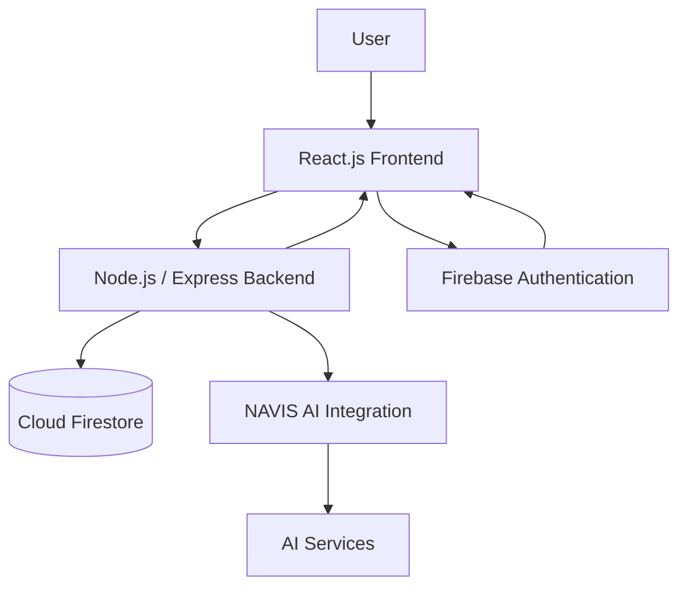

# LEITSTERN – System Architecture

## 1. Overview

LEITSTERN follows a full-stack application architecture that integrates a React.js frontend, Node.js and Express.js backend services, Firebase cloud infrastructure, and an AI integration layer.

The architecture separates user-facing application components from backend business logic, authentication, data management, and AI-powered functionality.

## 2. High-Level System Architecture

## 3. Frontend Architecture

**Technology:** React.js, JavaScript, HTML5, CSS3

The frontend provides the primary interaction layer between users and the application.

Key responsibilities include:

- Rendering responsive user interfaces.
- Managing application views and components.
- Displaying project and KPI information.
- Presenting interactive analytics and visualisations.
- Communicating with backend REST APIs.
- Supporting user authentication workflows.

## 4. Backend Architecture

**Technology:** Node.js, Express.js

The backend provides application services and handles communication between the frontend, database, and AI integration components.

Key responsibilities include:

- RESTful API development.
- Application business logic.
- Request processing.
- Database communication.
- Authentication-related operations.
- AI service integration.
- Structured application actions.

## 5. Authentication and Data Management

**Technologies:** Firebase Authentication, Cloud Firestore

Firebase provides cloud-based authentication and database capabilities.

Implemented functionality includes:

- User authentication.
- User and organisation management.
- Cloud-based data storage.
- Organisation-based data separation.
- Application data management.

## 6. NAVIS – AI Integration Layer

NAVIS is the AI-powered decision-support component within LEITSTERN.

Its purpose is to connect AI-generated insights with application functionality.

Developed capabilities include:

- Project health assessment.
- Risk detection.
- Intelligent recommendations.
- Cost optimisation insights.
- Structured AI-generated actions.
- Workflow automation.

NAVIS integrates AI services with backend application workflows to support user interaction with intelligent recommendations.

**Development status:** Further development and stabilisation are ongoing.

## 7. Application Data Flow

The general application interaction follows this sequence:

1. A user interacts with the React.js frontend.
2. The frontend communicates with backend services through REST APIs.
3. The backend processes application requests.
4. Relevant data is retrieved from or stored in Cloud Firestore.
5. AI-related requests are handled through the NAVIS integration layer.
6. Processed results are returned to the application.
7. The frontend presents the resulting information to the user.

## 8. Engineering Principles

The architecture follows several software engineering principles:

- Separation of frontend and backend responsibilities.
- API-based application communication.
- Centralised cloud-based data management.
- Modular application functionality.
- Authentication and access management.
- Integration of intelligent application services.
- Iterative development and maintainability.

---

**Project:** LEITSTERN  
**Developer:** Vishal Thaikkattil Vidyadharan  
**Technology Focus:** Full-Stack Development, Cloud Integration, AI-Powered Applications
