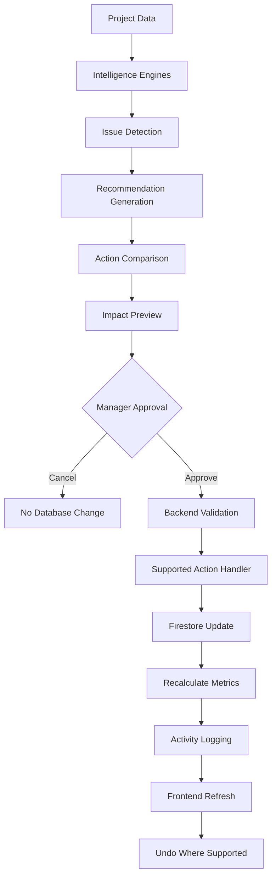

# LEITSTERN – Project Intelligence Engines

### Deterministic Analytics, Decision Intelligence and Controlled Automation

## 1. Overview

LEITSTERN incorporates a collection of deterministic decision-support engines designed to transform project-management data into actionable managerial insights.

These engines analyse project information, including task progress, deadlines, workload, estimated effort, actual effort, cost, budget, and priority.

Unlike conversational AI, these components use application-defined calculations, business rules, validation mechanisms, and scoring logic.

The objective is to help managers understand:

- What is happening within a project?
- Which tasks require attention?
- Where are operational or financial risks emerging?
- What actions could improve the situation?
- What is the expected impact of a proposed action?

The intelligence architecture combines measurable calculations with controlled managerial decision-making.

---

## 2. Intelligence Architecture

LEITSTERN contains several interconnected intelligence components.

| Engine | Primary Responsibility |
|---|---|
| Workload Intelligence | Workload distribution and utilisation |
| Cost Intelligence | Task and project cost calculations |
| Budget Intelligence | Budget utilisation and financial conditions |
| Deadline Intelligence | Deadline monitoring and urgency |
| Task Health Intelligence | Assessment of task conditions |
| Dynamic Priority Intelligence | Ranking tasks requiring attention |
| Task Decision Engine | Action comparison and recommendations |
| Smart Action Intelligence | Global action ranking and grouping |
| Resource Reallocation Engine | Workload and cost-based reassignment |
| Impact Preview Engine | Expected action impact |
| Undo System | Restoration of supported previous states |

These components operate alongside NAVIS, which provides conversational interaction and AI-assisted explanations.

---

## 3. Workload Intelligence Engine

The workload engine analyses assigned task effort against available team-member capacity.

Rather than relying only on the number of assigned tasks, LEITSTERN uses estimated working hours to understand workload distribution.

### Utilisation Calculation

```text
Utilisation (%) =
Total Assigned Estimated Hours
/
Available Capacity × 100
```

### Identified Conditions

- Overloaded team members.
- High workload conditions.
- Underutilised team members.
- Uneven workload distribution.
- Potential task reassignment opportunities.

A utilisation value above 100% indicates an overload condition.

### Resource Reallocation

The resource reallocation engine evaluates potential reassignment candidates using relevant information such as:

- Current assigned workload.
- Estimated task effort.
- Project membership.
- Organisation boundaries.
- Cost per hour.
- Potential cost impact.

Candidates are restricted to valid members of the relevant project.

The manager remains responsible for deciding whether reassignment is appropriate.

---

## 4. Cost Intelligence Engine

The cost intelligence engine calculates task-level financial information using recorded effort and member cost data.

### Core Calculations

**Estimated Cost**

```text
Cost per Hour × Estimated Hours
```

**Actual Cost**

```text
Cost per Hour × Actual Hours
```

**Remaining Cost**

```text
Estimated Cost - Actual Cost
```

These calculations provide visibility into planned expenditure, recorded expenditure, and remaining estimated cost.

### Project-Level Cost Analysis

Task-level values are aggregated to support project-level analysis.

The engine considers:

- Estimated project cost.
- Actual project cost.
- Remaining cost.
- Budget allocation.
- Budget utilisation.
- Potential overrun.
- Burn rate.
- Remaining project duration.

Changes to task assignments and relevant cost-related values trigger recalculation of dependent financial information.

---

## 5. Budget Intelligence Engine

The budget intelligence engine evaluates project financial conditions using available budget and cost information.

### Identified Conditions

- High budget utilisation.
- Potential budget overrun.
- High burn rate.
- Low budget runway.
- Financial risk.
- Potential cost-saving opportunities.

The engine provides financial visibility to support managerial decisions.

Its outputs depend on the accuracy and completeness of the underlying project data and should not be interpreted as guaranteed financial forecasts.

---

## 6. Deadline Intelligence Engine

The deadline engine analyses task deadlines and identifies conditions requiring managerial attention.

### Supported Conditions

- Overdue tasks.
- At-risk tasks.
- Upcoming tasks.
- Tasks requiring deadline intervention.

### Analytical Information

The engine can provide:

- Deadline status.
- Days remaining.
- Suggested deadline, where supported.
- Reason for the identified condition.

It also supports deadline-related recommendations and controlled changes.

Suggested deadlines are decision-support proposals rather than guaranteed completion predictions.

---

## 7. Task Health Intelligence

Task health provides an analytical interpretation of an individual task's current condition.

It considers relevant signals such as:

- Task priority.
- Task status.
- Progress.
- Deadline condition.
- Estimated effort.
- Cost context.
- Related project information.

A task may require attention when multiple negative conditions occur together.

For example, a high-priority task that is overdue, blocked, and progressing poorly may require more managerial attention than a task with a minor deadline delay.

Task health is calculated through application logic rather than treated as a simple manually maintained database field.

---

## 8. Dynamic Priority Intelligence

The Task Decision Engine incorporates dynamic priority scoring.

Its purpose is to identify tasks that deserve managerial attention based on their current operational condition.

### Relevant Factors

- Task priority.
- Health condition.
- Cost impact.
- Progress.
- Deadline-related condition.
- Urgency.
- Potential effect of available actions.

The resulting management view ranks tasks according to their current significance.

This provides a more informative approach than relying exclusively on manually assigned priority labels.

---

## 9. Task Decision Engine (TDE)

The Task Decision Engine extends conventional task management with structured decision-support capabilities.

It evaluates task conditions and provides potential managerial responses.

### Supported Actions

| Action | Purpose |
|---|---|
| Escalate | Increase managerial attention or intervention |
| Fast Track | Increase focus or urgency |
| De-scope | Consider reducing or adjusting planned scope |
| Pause | Temporarily stop or defer a task |

### Decision Comparison

The engine can compare multiple available actions for a task.

Relevant comparison information includes:

- Expected cost increase or decrease.
- Expected task-health improvement.
- Affected task fields.
- Recommended option.
- Visual indicators of expected results.

The recommendation is based on the implemented scoring logic and available project information.

It remains a decision-support recommendation rather than a mandatory managerial instruction.

---

## 10. Cost Optimisation Engine

The cost optimisation engine identifies potential financial improvement opportunities.

### Supported Action Types

**REALLOCATE_RESOURCES**

Identifies potential reassignment opportunities involving valid project members with relevant workload and cost characteristics.

**REDUCE_COST**

Identifies high-cost tasks and supports proposed adjustments to estimated effort.

**REDUCE_BURN_RATE**

Supports managerial responses when project spending is occurring rapidly relative to available budget and remaining time.

**MONITOR_SPENDING**

Highlights financial conditions requiring attention without automatically modifying project records.

### Cost Explanations

Recommendations can include:

- Current member cost per hour.
- Alternative member cost per hour.
- Task effort.
- Estimated cost difference.
- Potential savings.

These explanations provide additional context before a manager approves an action.

---

## 11. Smart Action Intelligence

LEITSTERN includes a Smart Action system that ranks available recommendations across different categories.

Instead of independently selecting the highest-ranked actions within each category, the system applies global prioritisation before grouping the selected actions.

### Action Categories

- Critical.
- Optimization.
- Monitoring.

This approach helps present the most relevant available actions rather than allowing category-specific selection to distort the overall priority.

The interface can initially display a limited selection of important actions and allow the manager to expand the complete list.

---

## 12. Impact Preview Engine

Before a supported action is executed, LEITSTERN can present an impact preview.

The purpose is to show the expected system-level consequences of a proposed change.

### Preview Information

Depending on the action, the preview may include:

- Expected cost change.
- Expected health change.
- Potential savings.
- Changed task assignment.
- Changed status.
- Changed priority.
- Changed estimated hours.
- Directional budget or burn-rate information.

The preview provides decision context before a database modification takes place.

It is based on available project information and implemented calculation logic, not a guarantee of future project performance.

---

## 13. Controlled Action Execution

LEITSTERN separates recommendation generation from actual project modifications.

### Execution Workflow



### Backend Validation

The documented execution workflow includes:

1. Firebase token verification.
2. Manager-role verification.
3. Organisation-context verification.
4. Assigned-project access verification.
5. Task, project, member, and action validation.
6. Retrieval of current database values.
7. Preservation of previous values where required.
8. Execution of the supported update.
9. Recalculation of dependent metrics.
10. Activity or task logging.
11. Returning the updated result to the frontend.

This ensures that supported operations pass through application-level controls.

---

## 14. Undo System

LEITSTERN includes undo support for supported actions.

The undo mechanism restores relevant previous values and recalculates dependent metrics.

### Restorable Information

Depending on the action, this can include:

- Assigned project member.
- Assigned member name.
- Priority.
- Status.
- Estimated hours.
- Actual hours, where supported.
- Cost.
- Progress percentage.
- Project-level financial totals.

Undo is particularly useful for resource reallocation, cost optimisation, deadline-related changes, and task-decision operations.

It provides managers with a controlled way to reverse supported project changes.

---

## 15. Integration with NAVIS

NAVIS operates as the conversational AI layer within the broader intelligence architecture.

The relationship between the components is:

| Component | Responsibility |
|---|---|
| Deterministic Engines | Calculate measurable project conditions |
| NAVIS | Provide conversational interaction and AI-assisted explanations |
| Backend | Validate requests and execute supported operations |
| Firestore | Store project and operational information |
| Manager | Review and approve decisions |

NAVIS does not replace the deterministic engines.

Instead, it helps managers interact with the information generated by these engines through natural-language questions, explanations, suggestions, and structured actions.

This creates a hybrid AI-assisted decision-support architecture.

---

## 16. Engineering Significance

The intelligence engines demonstrate practical implementation experience in:

- Business-rule development.
- Deterministic calculation logic.
- Workload analysis.
- Financial calculations.
- Budget monitoring.
- Deadline analysis.
- Dynamic prioritisation.
- Resource allocation.
- Decision-impact simulation.
- Recommendation ranking.
- Backend validation.
- Controlled database operations.
- Undo and activity logging.

These components extend LEITSTERN beyond conventional project tracking by introducing measurable project intelligence and structured managerial decision support.

---

## 17. Current Development Status and Limitations

The intelligence components represent implemented functionality within the current thesis-stage application.

Their outputs depend on the quality and completeness of manually maintained project data.

The system does not have complete knowledge of external dependencies, customer commitments, employee availability, contractual obligations, or all real-world project conditions.

Formal automated testing, comprehensive performance benchmarking, and independent validation of every recommendation remain areas for further development.

The engines should therefore be understood as decision-support mechanisms that assist managers rather than replace managerial judgement.

---

## 18. Conclusion

LEITSTERN's intelligence architecture combines deterministic project analytics, operational calculations, financial insights, dynamic task prioritisation, and controlled action execution.

By connecting these capabilities with NAVIS, the platform demonstrates how AI-assisted interaction can operate alongside explainable application logic and human-controlled managerial decisions.

The result is a project-intelligence environment designed to help managers understand operational conditions, evaluate alternatives, and make informed decisions.

---

**Project:** LEITSTERN  
**Component:** Project Intelligence and Decision Engines  
**Developer:** Vishal Thaikkattil Vidyadharan  
**Technologies:** React.js, Node.js, Express.js, Firebase, JavaScript
