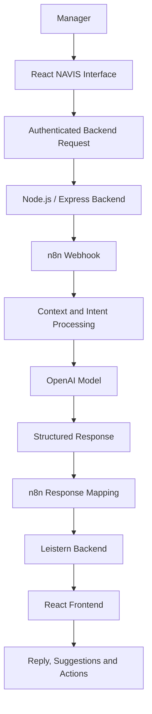
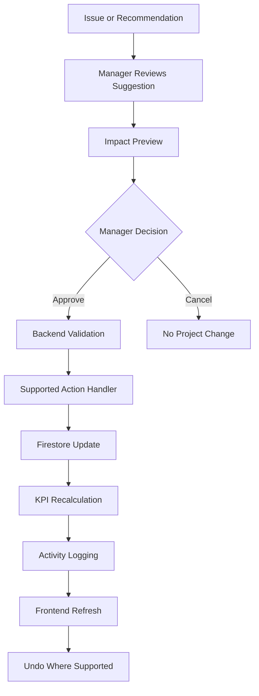

# NAVIS – AI-Powered Decision Support Engine

### The Conversational Intelligence Layer of LEITSTERN

NAVIS is the AI-assisted interaction and decision-support component of LEITSTERN. It connects project-related user queries with contextual project information, AI-generated explanations, intelligent suggestions, and structured action workflows.

Rather than functioning as an isolated chatbot, NAVIS operates within a broader software architecture that combines conversational AI, deterministic decision engines, backend business logic, and human-controlled action execution.

---

## 1. Overview

NAVIS was developed to make project information more accessible through natural-language interaction.

Managers can ask questions about project conditions and receive contextual responses, suggestions, and action-oriented outputs.

The component integrates:

- React-based conversational interface.
- Node.js and Express backend.
- n8n workflow orchestration.
- OpenAI model integration.
- Context-aware request processing.
- Structured AI responses.
- Backend-controlled action execution.
- Firestore-based application data management.

The primary objective is to connect AI-assisted interaction with practical project-management operations.

---

## 2. Technology Stack

| Component | Technology |
|---|---|
| Frontend | React.js |
| Backend | Node.js, Express.js |
| AI Model Integration | OpenAI API |
| Workflow Orchestration | n8n |
| Database | Firebase Cloud Firestore |
| Authentication | Firebase Authentication |
| API Communication | RESTful APIs |
| Application Logic | JavaScript |

---

## 3. NAVIS System Architecture

NAVIS follows a backend-mediated architecture connecting the frontend, application backend, workflow automation layer, and OpenAI model.

### High-Level Architecture



The backend acts as the intermediary between the frontend and n8n.

This separation allows LEITSTERN to apply authentication, project context, and access controls before AI-related requests are processed.

The frontend does not directly communicate with AI services for protected project operations.

---

## 4. Request Processing and Workflow Orchestration

NAVIS uses n8n as its workflow orchestration layer.

The documented request-processing workflow includes:

1. Receive the NAVIS request through an n8n webhook.
2. Extract the user's question and supporting context.
3. Identify the likely request intent.
4. Prepare the information for the AI model.
5. Send the prepared request to the OpenAI model.
6. Request a structured response.
7. Parse and map the generated output.
8. Return the structured result to the LEITSTERN backend.
9. Present the response through the React interface.

n8n coordinates AI-related processing but does not replace LEITSTERN's backend business logic or Firestore database.

---

## 5. Context-Aware Interaction

NAVIS receives a user question together with supporting contextual information.

The documented request context can include:

- Current user question.
- Previous question.
- Conversation or memory context.
- Selected project context, where relevant.

This allows NAVIS to interpret follow-up questions more effectively.

For example, when a manager asks about project workload and subsequently asks, "What should I do?", the previous interaction can provide context for interpreting the follow-up.

### Intent Detection

NAVIS includes rule-based intent detection within its n8n workflow.

Documented intent categories include:

- Delay analysis.
- Risk analysis.
- Workload analysis.
- Recommendations.

This classification helps the workflow prepare relevant context and prompts for different types of requests.

The documented implementation uses keyword-based logic rather than an independently trained machine-learning classifier.

---

## 6. OpenAI Model Integration

NAVIS uses an OpenAI model accessed through n8n.

The workflow prepares the user request and relevant context before sending it to the configured OpenAI model.

The model is instructed to act as NAVIS and return structured information rather than unrestricted conversational text.

This integration supports:

- Natural-language project interaction.
- Contextual explanations.
- Conversational project questions.
- Suggested follow-up questions.
- Recommendation presentation.
- Structured action suggestions.

The exact model identifier is intentionally not specified here because it should be taken from the configured n8n model node.

---

## 7. Structured AI Response Architecture

A major design principle of NAVIS is structured output.

The documented basic response contract contains three primary fields:

```json
{
  "reply": "Main natural-language response",
  "suggestions": [],
  "actions": []
}
```

### Response Components

| Field | Purpose |
|---|---|
| reply | Main natural-language response |
| suggestions | Suggested follow-up questions or relevant guidance |
| actions | Action-oriented outputs for the application interface |

Structured actions can contain additional information such as:

- type
- title
- description
- metadata

This creates a defined interface between AI-generated information and LEITSTERN's application logic.

The backend can identify supported action types and route them to corresponding application handlers instead of attempting to execute arbitrary AI-generated sentences.

---

## 8. Human-in-the-Loop Action Execution

A central principle of NAVIS is that an AI-generated recommendation does not automatically modify project data.

The system separates recommendations from actual application operations.

### Controlled Action Workflow



### Execution Process

1. An issue is identified or a recommendation is generated.
2. The manager reviews the proposed action.
3. The application displays an explanation or expected impact.
4. The manager confirms or cancels.
5. The backend validates the user's role and organisation context.
6. Project, task, and action information are validated.
7. The appropriate supported backend handler is executed.
8. Firestore records are updated.
9. Related KPIs are recalculated.
10. Relevant activity is recorded.
11. The frontend reflects the updated project state.
12. Undo is available for supported actions.

This architecture preserves managerial control and creates a safety boundary between AI-assisted recommendations and actual database modifications.

---

## 9. AI-Assisted Task Creation

NAVIS includes an AI-assisted task-creation workflow.

A manager can request task creation using natural language.

The system can return a structured instruction that opens the task-creation form rather than immediately creating an uncontrolled task.

The form can be pre-populated with extracted information such as:

- Task title.
- Priority.
- Assignee.
- Project.
- Date.

The documented implementation uses rule-based parsing to extract relevant information from the user's message.

It supports expressions such as "today", "tomorrow", and specified date formats.

The manager can review and modify the extracted information before creating the task.

Final task creation remains subject to normal backend validation, including organisation context, project context, assignment validation, and Firestore data checks.

---

## 10. Integration with LEITSTERN Decision Engines

NAVIS is not the only intelligence component in LEITSTERN.

The platform combines conversational AI with deterministic decision engines.

These engines calculate measurable project conditions using stored application data and defined business rules.

### 10.1 Workload Intelligence

Analyses estimated task hours and available capacity to identify:

- Overloaded team members.
- Underutilised team members.
- Workload imbalances.
- Potential reassignment candidates.

### 10.2 Cost and Budget Intelligence

Calculates and analyses:

- Estimated task cost.
- Actual task cost.
- Remaining cost.
- Budget utilisation.
- Burn rate.
- Potential cost overruns.
- Financial risk conditions.

### 10.3 Deadline Intelligence

Analyses task deadlines and identifies conditions such as:

- Overdue tasks.
- At-risk tasks.
- Upcoming deadlines.
- Tasks requiring managerial attention.

### 10.4 Task Decision Intelligence

Supports prioritisation and action recommendations through application-defined decision logic.

Documented task-decision actions include:

- Escalate.
- Fast Track.
- De-scope.
- Pause.

### 10.5 Resource and Cost Optimisation

The system evaluates valid project members and relevant workload and cost information to identify potential resource-reallocation opportunities.

Documented cost-related action types include:

- REALLOCATE_RESOURCES.
- REDUCE_COST.
- REDUCE_BURN_RATE.
- MONITOR_SPENDING.

These actions have different operational purposes and remain subject to the applicable review and execution controls.

---

## 11. Hybrid AI-Assisted Decision-Support Architecture

The distinction between conversational AI and deterministic application logic is fundamental to LEITSTERN.

| Function | Primary mechanism |
|---|---|
| Natural-language interaction | NAVIS / OpenAI |
| Conversational explanations | NAVIS |
| Follow-up suggestions | NAVIS |
| Structured action suggestions | NAVIS |
| Workload calculations | Deterministic engine |
| Cost calculations | Deterministic engine |
| Budget calculations | Deterministic engine |
| Deadline assessment | Deterministic engine |
| Task-health assessment | Deterministic engine |
| Priority scoring | Deterministic engine |
| Action validation | Backend application logic |
| Final project modifications | Approved backend handlers |

The OpenAI-connected NAVIS layer assists with conversation, interpretation, and structured responses.

The deterministic engines provide measurable and explainable calculations based on available project data.

This makes LEITSTERN a hybrid AI-assisted decision-support system rather than a conventional chatbot connected to a dashboard.

---

## 12. Safety, Validation and Limitations

AI-generated information can be incomplete or inaccurate.

LEITSTERN addresses this through several architectural controls:

- Deterministic calculations remain the source of measurable project values.
- AI responses follow a structured format.
- Only supported action types are connected to application handlers.
- Backend validation is applied before supported operations.
- Managers review recommendations before execution.
- Impact previews provide additional decision context.
- Activity logging supports transparency.
- Undo is available for supported actions.

These controls reduce the risk of uncontrolled AI-driven operations but do not guarantee that every AI-generated response is correct.

The quality of NAVIS responses also depends on the completeness and accuracy of the underlying project data.

---

## 13. Development and Validation Status

NAVIS and its connected workflows have been manually tested during development.

Documented manual testing includes:

- Request processing.
- Response parsing.
- Frontend response rendering.
- Suggestion handling.
- Structured action handling.
- Approval workflows.
- Task updates.
- Error debugging and fixes.

Formal automated testing, systematic AI-response quality benchmarking, hallucination testing, load testing, and production monitoring are not established as current validation evidence.

NAVIS is therefore presented as an implemented AI-assisted development component undergoing further stabilisation and improvement.

---

## 14. Engineering Significance

NAVIS demonstrates practical experience in:

- Integrating OpenAI models into full-stack applications.
- Building backend-mediated AI workflows.
- Orchestrating AI processes using n8n.
- Processing contextual user requests.
- Designing structured AI response contracts.
- Connecting AI recommendations with application functionality.
- Separating AI-generated suggestions from executable operations.
- Implementing human approval and backend validation.
- Combining conversational AI with deterministic decision engines.

The architecture demonstrates an approach to integrating AI into operational software while retaining application-level validation and human decision authority.

---

## 15. Future Development

Potential areas for further development include:

- Automated testing of AI workflows.
- Systematic evaluation of response quality.
- Improved context handling.
- More comprehensive data-quality validation.
- Expanded analytical capabilities.
- Performance and reliability validation.
- Stronger operational monitoring.

These areas represent future development opportunities rather than claims of currently completed functionality.

---

## 16. Conclusion

NAVIS is the conversational AI and structured decision-support component of LEITSTERN.

Its architecture combines a React interface, Node.js and Express backend, n8n workflow orchestration, and an OpenAI model to provide contextual responses, suggestions, and structured action outputs.

Its integration with deterministic project-intelligence engines allows LEITSTERN to combine measurable operational calculations with AI-assisted interaction.

Most importantly, the system preserves human decision authority: recommendations are reviewed, supported actions are validated by the backend, and project modifications remain controlled application operations.

---

**Project:** LEITSTERN  
**Component:** NAVIS – AI-Powered Decision Support Engine  
**Developer:** Vishal Thaikkattil Vidyadharan  
**Primary Technologies:** React.js, Node.js, Express.js, OpenAI API, n8n, Firebase

**Live Application:** https://leistern-frontend.onrender.com
